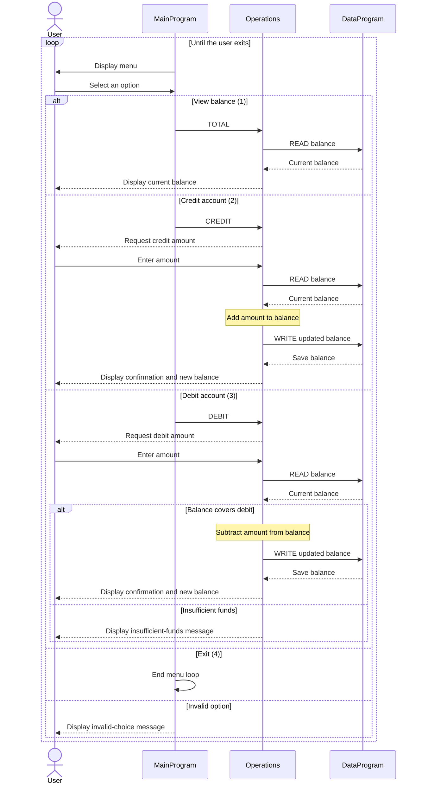

# Student Account Management

## Running the Node.js application

The three COBOL programs are consolidated in [src/accounting/index.js](../src/accounting/index.js).
Install Node.js 22 or newer, then run:

```sh
cd src/accounting
npm install
npm start
```

No third-party packages are required; the application uses Node.js built-in modules.
Run the automated CLI tests with `npm test` from the same directory.
In VS Code, select **Run Accounting Application** in Run and Debug and press F5.
The launch configuration uses the integrated terminal so menu input works.

The Node.js implementation follows the data flow below: select an operation, read
the shared balance, calculate, and update it only for a successful transaction.
It preserves all four menu options, messages, the initial `1000.00` balance, and
process-local storage. Like COBOL, balance output is eight digits with an implied
decimal point: `00100000` means `1000.00`. Zero-value transactions remain valid.
Restarting the application resets the balance.

Amounts are calculated in integer cents to avoid floating-point rounding errors.
For previously undefined inputs, the approved modernization behavior is to reject
negative or malformed values, amounts outside `0` through `999999.99`, and credits
that would exceed `999999.99`, with an explicit message and no balance change.
Enter amounts as one to six digits with an optional decimal point followed by one
or two digits (for example, `25`, `25.7`, or `25.75`); surrounding whitespace is ignored.
End of input exits cleanly and cancels any incomplete transaction.

## Legacy COBOL reference

This COBOL example demonstrates a simple account-management flow for a student account. It maintains one account balance and supports viewing the balance, adding a credit, and making a debit. It does not store student names, IDs, or multiple accounts.

## Source Files

### `src/cobol/main.cob` - `MainProgram`

Runs the command-line menu and dispatches the user's selection to `Operations`:

- `1` calls `Operations` with `TOTAL` to display the current balance.
- `2` calls it with `CREDIT` to add funds.
- `3` calls it with `DEBIT` to subtract funds.
- `4` exits the menu loop.
- Any other selection displays an invalid-choice message.

### `src/cobol/operations.cob` - `Operations`

Implements the account actions. It reads the current balance from `DataProgram` before changing or displaying it, and writes the updated balance after a successful credit or debit. For credits and debits, it prompts for an amount and displays the result.

### `src/cobol/data.cob` - `DataProgram`

Provides a small in-memory balance store. Its `READ` operation copies the stored balance to the caller; `WRITE` replaces the stored balance with the value supplied by the caller. The balance starts at `1000.00` and remains available across calls while the program is running.

## Student Account Rules

- The example has one shared account balance, initialized to `1000.00`.
- A credit adds the entered amount to the balance and saves the result.
- A debit is allowed only when the current balance is greater than or equal to the entered amount. Otherwise, the balance is unchanged and an insufficient-funds message is displayed.
- Viewing the balance does not change it.
- The amount and balance fields use `PIC 9(6)V99`, representing up to six integer digits and two decimal digits with an implied decimal point.
- The balance is held in working storage, not persisted to a file or database; it returns to the initial value when the program starts again.
- The code does not identify students or implement separate accounts. It also has no explicit business validation for zero amounts, maximum balances, or arithmetic overflow.

## Application Data Flow




